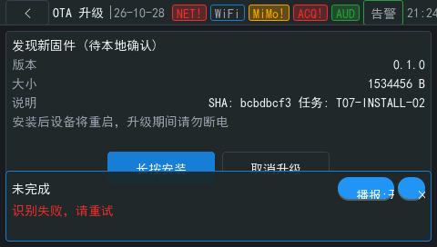

# 语音浮窗按钮文字错位与关闭不可用

状态：已修复，主机无头测试与板端几何诊断通过；真实触摸验收待用户完成。

发现日期：2026-10-28。来源：OTA 第七阶段真机验收，用户明确要求列入待修复列表。

## 实际表现

在 READY 页面按实体 USER 键会触发现有按住说话功能。网络识别失败后，底部语音浮窗显示未完成、识别失败，请重试；播报和关闭按钮文字错位，用户无法正常关闭浮窗，遮挡屏幕上的长按安装按钮。

本次串口确认 OTA 仍为 `READY_AWAITING_CONFIRM`，A 槽运行，BCB 不存在，没有发生安装。实体 USER 当前绑定语音；本阶段 OTA 的常规确认入口是屏幕蓝色长按安装按钮。

## 待处理

- [x] 修复 480×272 屏幕下播报、关闭按钮的文字布局、裁剪与点击区域。
- [x] 验证录音中、识别中、识别失败及播报结束时关闭均能退出浮窗。（无头指针；板端 `vgvoice round overlay` 几何命中均为 1）
- [x] 验证浮窗退出后原页面按钮可正常触摸。（无头指针点击被遮挡的底部导航并切页成功；真实触摸归入下一项）
- [ ] 使用真实触摸操作完成验收，保留修复前后截图及事件结果。

修复前截图：。

涉及代码：`gui/main/ui/widgets/vg_voice_overlay.c`。根因已确认：按钮沿用 LVGL 默认主题的 16 px 水平、10 px 垂直内边距且标签未居中，固定尺寸按钮内标签向右下溢出，重试标签覆盖关闭按钮，关闭符号贴边。修复、测试和截图见[语音浮窗修复证据](../../ota-evidence/2026-10-29/voice-overlay.md)。

当前可用的维护退出方式为 `vgvoice round end`。它只结束语音会话，不确认 OTA，也不修改点表。该方式不替代后续的屏幕关闭验收。
