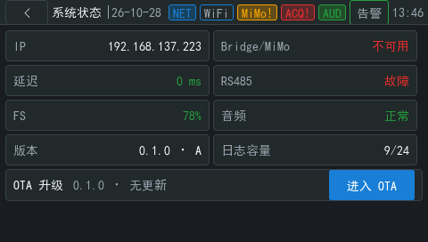
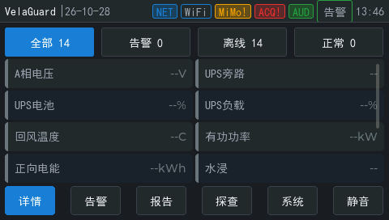

# OTA P1 固件身份、槽位与安全重启

日期：2026-10-28。板：STM32H750B-DK。固件：`velaguard-lvgl`，版本 `0.1.0`，A 槽。构建号 `1f65df15ba07-dirty`（提交前工作区构建）。

## 单一版本来源

- 仓库根目录 `VERSION` 为唯一版本来源，构建脚本校验 `MAJOR.MINOR.PATCH` 后生成 `build/velaguard/vg_fw_build.h`。
- `vg_fw_identity.c` 提供版本、构建号、槽位和链接基址；MQTT status、系统页、`vgota` 和后续 OTA 共用这一来源。
- 代码中不再保留固定的固件版本字符串。MQTT 合同新增 `slot` 字段。

## A/B 镜像元数据

构建命令：

```text
bash scripts/build.sh
```

构建检查输出：

```text
check_fw_images: OK version=0.1.0 A=0x90000000 B=0x90800000 a_size=1511888 b_size=1511888
```

ELF 符号：

```text
$ nm -g --defined-only .debug/nuttx-a.elf
90000000 A _stext
90000000 T __vg_link_base
00000041 A __vg_slot_letter

$ nm -g --defined-only .debug/nuttx-b.elf
90800000 A _stext
90800000 T __vg_link_base
00000042 A __vg_slot_letter
```

两份 BIN 都含有版本和构建号：

```text
$ strings .debug/nuttx-a.bin | grep -E '^0\.1\.0$|^1f65df'
0.1.0
1f65df15ba07-dirty

$ strings .debug/nuttx-b.bin | grep -E '^0\.1\.0$|^1f65df'
0.1.0
1f65df15ba07-dirty
```

`check_fw_images.py` 还校验向量表初始 MSP、复位入口位于各自槽内、Thumb 位、8 MiB 槽位上限，以及 A/B 二进制不相同。两镜像由同一批对象重新链接，只有链接脚本的 flash 基址、槽位长度和绝对槽位标记不同。当前 boot stub 仍只启动 A；B 镜像留给后续 BCB 选择和安装票使用。

## 主机测试

```text
$ ./test_fw_identity
test_fw_identity: OK

$ ./test_mqtt_payload
test_mqtt_payload: OK

$ make -C app/velaguard/host_tests test
...
./test_ota_probe
test_ota_probe: OK
./test_fw_identity
test_fw_identity: OK
...
```

`test_fw_identity` 覆盖版本格式、非法输入、身份格式化缓冲区边界、槽位标记优先级和 B 槽地址边界。`test_mqtt_payload` 断言 status 载荷包含同一 `firmware` 和 `slot`，并拒绝空版本、空槽位和过小缓冲区。

## 板级身份与重启

烧录并启动后：

```text
nsh> vgota identity
vgota: identity version=0.1.0 slot=A build=1f65df15ba07-dirty link=90000000
```

通过 OTA 安全重启接口重启：

```text
nsh> vgota reboot
vgota: safe reboot version=0.1.0 slot=A
```

重启后：

```text
nsh> cat /proc/uptime
     24.59
nsh> vgota identity
vgota: identity version=0.1.0 slot=A build=1f65df15ba07-dirty link=90000000
```

重启前版本和槽位与重启后一致。`vgota reboot` 先 `sync()` 已挂载文件系统，再调用板级复位；后续 OTA 服务复用同一入口。

重启后再次执行 `vgota probe`，eMMC 仍为 FAT16、64 KiB 簇，剩余空间 3,884,580,864 字节；QSPI 仍为 `state=ok`，说明重启和身份改动没有格式化 eMMC，也没有触碰 A/B 槽。

## 屏幕

系统页显示 `版本 0.1.0 · A`，OTA 行显示 `0.1.0 · 无更新`：



首页底部新增 `系统` 入口，六个按钮在 480 像素宽度内排布正常：



截图为 ST-Link 读取 LTDC 帧缓冲后转换。为在没有触摸输入的情况下进入系统页，诊断构建临时把初始页设为系统页；随后已恢复首页启动并重新构建、烧录。最终固件保留 `系统` 按钮和系统页导航，`vg_app.c` 的临时改动未提交。

## 限制

- 本票只提供安全重启入口和身份来源，不实现 OTA 状态机、BCB 或 B 槽启动；这些由后续票实现。
- 板级 status 载荷由主机测试覆盖，未在本票单独抓取 MQTT 报文；板端 `vgota identity` 和系统页使用同一版本/槽位访问器。
- `vgota reboot` 当前只同步文件系统后复位，不检查尚未实现的 OTA 事务；安装确认票会在调用前增加联锁检查。
