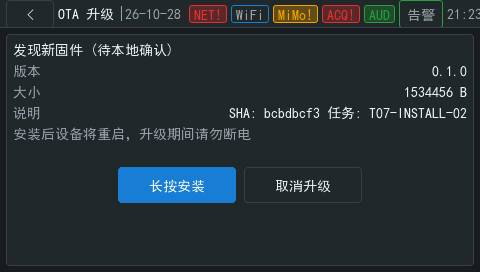

# OTA 任务 07：本机安装确认与交接

日期：2026-10-28。

状态：实现与主机测试完成，真机 READY、串口拒绝、取消和持久拒绝记录通过；等待用户在屏幕完成安装确认，再收集 B 启动和 confirmed 证据。当前不能标为完整板级验收通过。

## 实现

- 常规安装入口是屏幕上的长按安装按钮，按下后持续 2 秒才接受一次确认；松手、移出按钮和任务变化会取消本次按压。实体 USER 仍绑定现有按住说话功能，不是常规 OTA 安装按键。
- C 确认端口只接受触摸或按键来源，拒绝串口、MQTT、手机、语音和设备端 Agent。NSH `vgota confirm` 在 READY 时只提示使用板载输入，不写 pending，不重启。fixture 按键等待属于显式测试入口，仍要求真实释放和长按，并使用同一联锁。
- 确认前检查活动严重告警、暂存可写、镜像文件大小和完整 SHA-256、设备配置空闲及 RJ45 链路。再次绑定 task_id、版本、大小、摘要和 B 槽；非 fixture manifest 还必须在有效系统时间和签发时间窗内。
- 暂存、确认、取消与超时共用递归互斥锁；已有 READY 任务不能被其他 Offer 替换。任何联锁失败均保持 READY，保留原因，不写 pending、不重启。
- pending 先写独立 8.3 临时文件，fsync、关闭并解码回读核验，再替换目标 BCB。失败时保留 READY；成功后同步并复位，交给现有 boot stub 安装和 B 槽自检。
- READY 的 10 分钟期限使用单调时钟，由应用后台检查，不依赖 OTA 页面是否打开。取消和超时清除镜像及 manifest，保留任务元数据，并在 `SUPPRESS.BIN` 追加 CRC 记录；重启后仍拒绝原 task_id，不按固定缓存容量淘汰旧记录。记录损坏时保守拒绝新 Offer。
- 屏幕显示真实版本、镜像字节数、摘要前缀和任务标识。取消、超时与 confirmed 使用真实状态；板端不使用模拟升级进度证明成功。

## 主机测试

执行 `make -C app/velaguard/host_tests test` 成功，63 个 C 测试程序及启动栈、板级引脚脚本均通过。本任务新增 `test_ota_confirm`，覆盖：

1. 允许触摸/按键，拒绝 UNKNOWN、LOCAL_CLI、MQTT、PHONE、VOICE、AGENT；拒绝后不重启、状态仍为 READY。
2. 五项联锁逐项失败，缺失联锁回调时保守拒绝。
3. 两份 BCB、pending 本地确认标志、序号、task_id 与版本绑定，以及成功后仅一次重启。
4. pending 临时文件 fsync、回读或 rename 失败均不暴露 pending、不重启，后续新的人工确认可以重试。
5. manifest 被另一个 CRC 正确的任务替换时拒绝；新 Offer 不能覆盖 READY 任务。
6. 期限前一毫秒保持 READY，到达 10 分钟进入 EXPIRED，删除暂存且保留原 task_id。
7. 取消及超时后相同任务被拒绝；重置内存后仍拒绝；八个取消记录不淘汰第一条；损坏尾记录保守拒绝新任务。

已有 `tool_shell.c` 的 VelaGuard 元数据允许列表没有 `vgota`，设备端 Agent 也没有本地输入端口的调用路径。主机来源矩阵验证的是确认服务的拒绝行为；不把它称为完整网络攻击测试。

## 构建

fixture 构建：`bash scripts/build.sh --ota-fixtures`。

```text
check_fw_images: OK version=0.1.0 A=0x90000000 B=0x90800000 a_size=1534456 b_size=1534456
```

生产构建：`bash scripts/build.sh`。

```text
check_fw_images: OK version=0.1.0 A=0x90000000 B=0x90800000 a_size=1524776 b_size=1524776
# CONFIG_VG_OTA_TEST_FIXTURES is not set
```

生产 ELF 中没有 `fixture_offer`、`fixture_arm` 或 `cmd_interlock` 符号；运行期 fixture 拒绝检查待收尾烧录后记录。

## 真机已取得的证据

设备：STM32H750B-DK，COM3。使用 STM32CubeProgrammer 将 B 镜像传输副本写入既有测试窗口 `0x91000000`，B 槽仍由 boot stub 安装；本任务没有格式化 eMMC，也没有应用或修改点表。

### READY、串口拒绝与取消

首轮诊断镜像实测摘录（当时镜像大小 1534248 B）：

```text
vgota: offer ACCEPTED into READY: task=T07-CANCEL ver=0.1.0 bytes=1534248
vgota: installation requires board touch or button long press
vgota: state=READY_AWAITING_CONFIRM task=T07-CANCEL ver=0.1.0 size=1534248 sha=6ff20cbe err=none
vgota: fixture BCB0.BIN missing ERR=2
vgota: fixture BCB1.BIN missing ERR=2
vgota: task=T07-CANCEL DECLINED (user_declined)
vgota: offer REJECTED: task_suppressed ERR=-114
```

这次取消通过维护命令完成，只证明服务侧取消与落盘，尚不能替代屏幕取消按钮的触摸验收。后续修复了重复 Offer 覆盖状态的问题，并增加保持原终态的回归测试。

重烧、复位后再次提议 `T07-CANCEL`，仍返回 `task_suppressed`，证明拒绝记录跨重启有效。

### 最终 fixture READY 与屏幕

```text
vgota: offer ACCEPTED into READY: task=T07-INSTALL-02 ver=0.1.0 bytes=1534456
vgota: state=READY_AWAITING_CONFIRM task=T07-INSTALL-02 ver=0.1.0 size=1534456 sha=bcbdbcf3 err=none
eth0 Link encap:Ethernet ... at RUNNING
```

RJ45 链路 RUNNING，无 IPv4 地址；fixture 从本地测试窗口读入，不依赖互联网下载。真实 HTTPS/MQTTS 验收不在这份证据范围内。



首次屏幕复核发现导航层仍拦截 OTA 页面；本任务已移除 OTA 占位门槛，最终截图验证页面自动显示、按钮和元数据可见。

### 人工操作与待修复事项

用户首次按了实体 USER 键，触发现有语音功能。串口与屏幕快照证实 OTA 仍为 READY、A 槽运行且没有 BCB。用户随后报告语音浮窗按钮文字错位、无法关闭，已按要求新增[待修复任务](../../issues/ui/voice-overlay-controls.md)，本阶段没有修改语音界面。

执行 `vgvoice round end` 后回报 `cancel_settled`，该命令只结束语音会话，不确认 OTA。屏幕长按、安装到 B 和自检 confirmed 尚待本轮后续记录。

## 验收限制

- 10 分钟真实等待、屏幕点击取消、联锁拒绝及 pending 写失败的板级矩阵尚未全部实测；相关确定性行为由本轮主机测试覆盖。
- 生产签名验证、HTTPS 下载、MQTTS 状态与结果补报属于后续任务 08/09，本任务不声明它们完成。declined/expired 当前在本地状态和 FAT 文件记录。
- 本轮不声称执行过断电注入、环境可靠性认证或持续长测。
