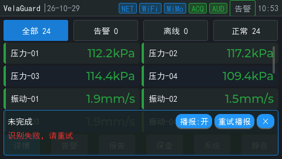

# 语音浮窗布局与关闭修复

日期：2026-10-29。对应[语音浮窗缺陷](../../issues/ui/voice-overlay-controls.md)与 OTA 验收待办第一项。

## 结论

浮窗按钮文字错位和关闭不可用的直接原因已定位并修复：按钮沿用了 LVGL 默认主题给 480×272 小屏设置的 16 px 水平、10 px 垂直内边距，标签没有居中；固定尺寸按钮内的标签因此向右、向下溢出，重试标签覆盖关闭按钮区域，关闭符号贴边显示。修复后按钮文字完整落在按钮内，关闭按钮在录音、识别、失败和结果态都能结束本轮并立即隐藏浮窗。

主机无头测试、板端真实 LVGL 渲染和 `vgvoice overlay` 几何诊断通过。真实手指触摸关闭、浮窗退出后触摸原页面按钮仍待用户完成，不能用合成按键或串口命令代替。

## 根因

修改前实测控件树（480×272）：

```text
btn 62x24 at 305,195
  label 49x17 at 321,205 text='播报:开'
btn 62x24 at 371,195
  label 56x17 at 387,205 text='重试播报'
btn 30x24 at 437,195
  label 14x17 at 453,205 text='×'
```

标签从按钮内容区左上角开始排版，水平偏移 16 px、垂直偏移 10 px。重试标签实际覆盖到 x=443，而关闭按钮从 x=437 开始；标签高度 17 px 超出按钮剩余内容高度，底部被裁剪。关闭符号虽然仍能被命中，但显示在按钮最右边缘，用户看到的可点击区域和按钮边界不一致。

## 修复

文件：[gui/main/ui/widgets/vg_voice_overlay.c](../../../gui/main/ui/widgets/vg_voice_overlay.c)

- 新增 `overlay_button()`：按钮内边距清零，标签创建后 `lv_obj_center()` 居中；重试按钮宽度从 62 调整为 68，四字标签保留左右余量。
- 状态标签使用 `lv_obj_set_flex_grow(..., 1)` 和 `LV_LABEL_LONG_DOT`，长状态文本只截断自身，不再把右侧按钮挤出面板。
- 关闭回调先按当前 `generation` 标记本地隐藏，再调用 `vg_voice_round_end()`；轮次在工作线程收尾期间浮窗保持隐藏，下一轮 generation 变化后正常显示。
- `vg_voice_overlay_destroy()` 清除关闭状态。

修复后控件树：

```text
btn 62x24 at 299,195
  label 49x17 at 306,199 text='播报:开'
btn 68x24 at 365,195
  label 56x17 at 371,199 text='重试播报'
btn 30x24 at 437,195
  label 14x17 at 445,199 text='×'
```




## 主机验证

`make -C app/velaguard/host_tests test` 通过。

`.debug/ui-memory-audit-system/voice_overlay_check` 通过，新增断言覆盖：

- 录音、识别、失败和结果态下，播报、重试、关闭按钮都在 480×272 屏幕内。
- 每个按钮的标签完整落在按钮坐标内。
- 点击关闭按钮通过真实 LVGL 指针 indev 触发 `vg_voice_round_end()`，浮窗隐藏。
- 快照仍显示本轮内容时，关闭后的浮窗保持隐藏，等待工作线程收尾。

`ctest` 的 6 个无头检查全部通过（alarm、trend、fixture、lifecycle、interaction、voice_overlay）。

## 板端几何诊断

烧录本次主线构建后，用语音诊断入口触发一轮识别失败（ASR 返回 429），读取真实 LVGL 渲染结果：

```text
vgvoice round overlay
overlay: panel=468x78 at 6,188 screen=480x272 visible=1
overlay: answer_box=h17 scroll_bottom=0 label_h=17
overlay: mute=62x24 at 371,195 hit=1
overlay: retry=68x24 at 371,195 visible=0 hit=1
overlay: close=30x24 at 437,195 hit=1
vgvoice round text
e=识别服务返回错误，请重试
vgvoice round end
[vgvoice] cancel_settled elapsed_ms=10 retained_pcm=0 controlled_active=0
```

三个控件的中心命中测试均为 1，关闭按钮位于面板内。`round press/release/end` 是诊断入口，不能替代用户触摸，也不能确认 OTA。

## 未完成

- 用户用手指在屏幕上关闭浮窗，覆盖录音中、识别中、识别失败和播报结束四种状态。
- 浮窗关闭后，点击被遮挡的原页面按钮，确认触摸不再被顶层浮窗拦截。
- 修复前后真机照片或屏幕截图，需在用户操作时保留。
