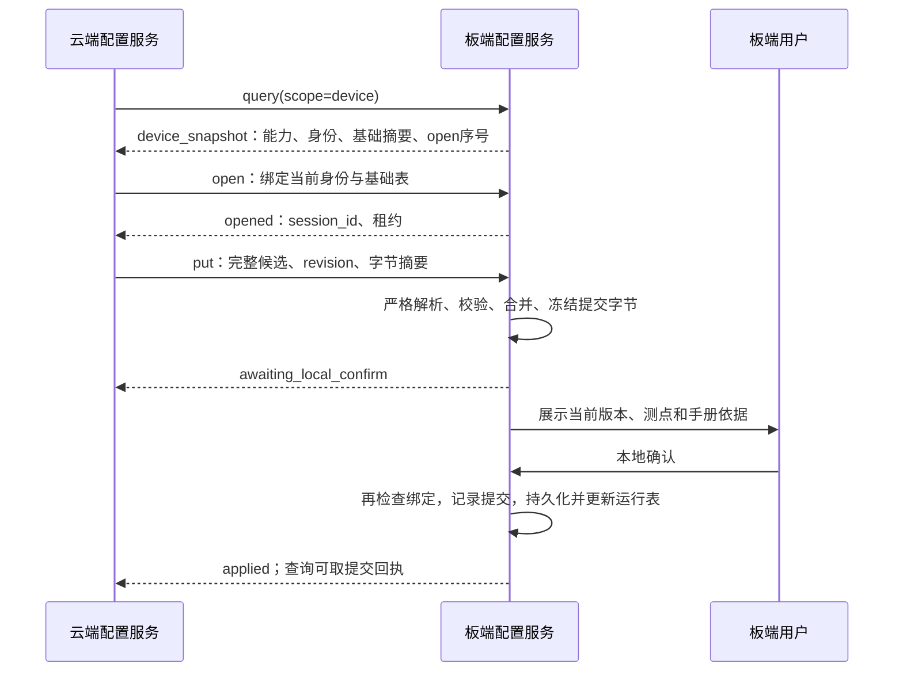

# VelaGuard 云端候选点表：板端协议实现计划

日期：2026-11-05。状态：板端候选核心、安全 MQTT 与本地确认已实现；安全 MQTT 已通过局域网 TLS Broker 和生产环境真机验收，生产 MQTTS、云端 PDF 服务和网页接入页已在 aliwh 启用。

本计划先落实板端协议，云端 PDF 上传、解析和网页在后续任务接入。消息结构唯一依据为 [候选协议 v0.3](velaguard-candidate-mqtt-protocol.md)，产品决策见 [ADR 0007](adr/0007-mqtt-candidate-import-with-local-confirmation.md)，全链路见 [网页接入计划](velaguard-web-sensor-onboarding-plan.md)。本文只细化模块、开发顺序和验收，不另定义消息版本。

## 1. 交付目标

板端接收云端整理后的带来源候选，完成确定性校验，弹出本地人工确认；用户确认当前候选后持久化并加入正常采集。PDF 本体留在云端，板端只接收所选测点、页码、原文摘录和文件摘要。

首版仅新增一个尚未使用的从机地址，固定 9600、FC03/04、int16/uint16、qty=1、offset=0，合并后最多 32 点。倍率必须有限且转换到实际 float 后有限、非零。已有测点及规则保留，新点不从手册测量范围推导告警阈值。公式、float32、32 位整数和字序扩展另行实施。

确认前不对新增候选发送 Modbus 请求，不试读。进度、等待和结果通过协议交给云端展示；板端只显示人工确认，本地告警优先。配置生效与从机在线分开报告。

## 2. 当前代码与复用判断

| 代码 | 当前事实 | 本次实施方式 |
|---|---|---|
| `app/velaguard/vg_mqtt_session.c` | 遥测明文会话，RX 为 512 字节，接收回调忽略消息 | 保留上报职责，新增隔离的候选 MQTTS 适配器 |
| `vg_ota_mqtt.c`、`vg_ota_https.c` | 已有 OTA 专用 MQTTS/TLS 代码、订阅等待和 PAL 接入 | 评估复用 TLS 底层；独立 client_id、主题、凭证权限、连接状态和缓冲，不直接借用 OTA 会话 |
| `vg_ota_json.c` | 有 NUL、字符串、嵌套深度初步检查，深度上限 4 | 不能承担本协议的严格解析；另做重复键、UTF-8、代理项、未知字段和深度校验 |
| `vg_ota_entropy.c` | 有随机源探测代码 | 核对可用随机接口，产生协议要求的 128 位身份；探测函数本身不提供身份生成接口 |
| `vg_point_table.c` | 提交锁覆盖文件替换、内存表更新和通知；运行表 JSON 上限 16384 字节 | 增加共享配置入口仲裁及提交冻结字节的能力，保留现有调用兼容 |
| `vg_file_store.c/.h` | 文件替换、备份和写入串行化；文件名分量预算 32 字符 | 复用有界文件操作，新增跨文件提交记录和启动核对；不能据此宣称 FAT 掉电原子性 |
| `vg_config_store.c/.h` | 双槽对象主要为设备名称等配置元数据 | 不将其误作完整测点表事务存储 |
| `vgpoint.c` | 本地候选、试读和人工 apply 入口 | 保留 NSH 流程，加入入口互斥，始终不能读取远程候选 |

以上来自当前源码静态核对，不构成已有 OTA 或候选链路的本次板验。旧网页计划关于 MQTTS 全部待建的描述，需要结合已有 OTA 专用实现理解；候选专用安全通道仍待实现。

## 3. 协议闭环

仅开放 `query / open / put / cancel`。MQTT 没有 test、apply 或 confirm。query 可查询设备快照、当前任务和最近提交回执；PUBACK 只确认传输，云端依据 applied 或核对后的 receipt 判断生效。

主题沿用 `vg/{device_id}/config/request` 与 `vg/{device_id}/config/state`，QoS 1、非 retained、CleanSession=1。连接完成 CONNACK 和有效 SUBACK 后才开放请求处理。Broker 侧同时限制方向、设备范围和 retained 发布；设备侧仍检查 retain 标记与会话身份。

状态沿用 `opened → validating → awaiting_local_confirm → committing → applied`，终态包含 cancelled、expired、failed、recovery_unknown。校验内容错误回到 opened，当前确认失效；身份或摘要等受理前检查失败不改变活动候选。错误码与响应字段完全沿用协议草案。

## 4. 模块与线程职责

以下文件名为实施建议，具体接口在首项开发中确定。

| 模块 | 职责 |
|---|---|
| `vg_config_protocol.c/.h` | 消息解析、严格字段验证、请求关联、响应编码；生成黄金消息用例 |
| `vg_config_candidate.c/.h` | 候选能力、来源引用、地址换算、冲突、容量校验；生成合并表及摘要 |
| `vg_config_session.c/.h` | 身份、open 序号、固定租约、版本、幂等、处理代次与状态机；可在主机测试 |
| `vg_config_gate.c/.h` | 远程、NSH、扫描配置写入的统一所有权；与 OTA 安装互锁 |
| `vg_config_transaction.c/.h` | 原始候选、依据、冻结运行表、提交记录、回执及启动恢复 |
| `vg_config_mqtt.c/.h` | 候选专用安全连接、订阅、复制入队、状态发送、断线事件 |
| `vg_config_service.c/.h` | 组装后台工作线程、时钟、随机源、存储、UI 与通信适配器 |
| 本地确认 UI 适配 | 从不可变快照绘制确认界面，仅向配置服务投递本地用户事件 |

MQTT 回调只检查主题及长度、复制到有界队列并返回，不做文件 I/O、候选校验或 LVGL 调用。工作线程处理解析、校验和存储；UI 线程只绘制及投递事件。队列满时不改任务状态，安全可识别的请求返回有界错误；为取消、断线、过期和本地事件保留处理能力。

配置所有权跨整个会话持有，但不长期持有线程互斥锁或 RS485 总线锁。短临界区保护状态、确认绑定及提交竞争；校验和 I/O 在临界区外进行，结果带处理代次回收。既有正常采集继续运行。统一规定锁顺序，避免 UI、提交锁、运行表锁与文件锁相互等待。

## 5. 必须落到代码的约束

1. **严格解析。** 外层与 candidate_json 都拒绝重复键、未知字段、非法 UTF-8、未配对代理项、NUL、越界整数和异常数值；设置明确嵌套深度、对象数及 token 预算。候选摘要按外层解码得到的原始 UTF-8 字节计算，禁止先重排或格式化。
2. **身份与幂等。** boot/link/session/confirmation 身份用验证过的随机源生成。open 序号在同一次启动中只增不回绕；同 req_id 同内容不重复落盘、弹窗或续租，异内容报 req_conflict。缓存只保存有界关联和摘要，不保留 31 份完整候选。
3. **入口互斥。** open 与 NSH 候选编辑、试读、apply、扫描及其他配置写入原子竞争所有权。需明确 NSH 所有权从首次候选操作持有到 apply/abort，不能只给单条命令加锁；历史候选首次访问时重新核对基础表。扫描仅在维护入口显式开启。远程候选文件与 NSH 文件物理隔离；只读入口继续可用。OTA 安装和配置事务互斥，OTA 下载是否并行依据资源测量决定。
4. **确认绑定。** UI 事件携带 task/session/revision/payload_sha256/base_hash/candidate_hash/confirmation_id。新版 put 通过受理检查后立即废止旧确认；后台迟到结果、旧点击和双击不能提交。断线、取消、过期及重启在 committing 前使确认失效。
5. **告警优先。** 告警抢占时隐藏并禁用确认。恢复显示前重新验证租约、连接、版本和绑定；失效则关闭。告警遮挡期间排队的旧点击必须拒绝。
6. **确定性提交。** 校验后冻结完整目标表字节，确认时在提交互斥区再核对基础表与绑定。新增提交接口写入同一份字节并更新对应内存表，不能确认后调用旧序列化流程生成另一份文件。运行表更新与通知成功条件需要显式处理。
7. **最小权限。** 候选服务仅由确定性入口调用，设备端 Agent 不注册这些工具。MQTT 不接收命令字符串、文件路径、告警阈值或执行字段。日志仅记身份、摘要、错误码和有界字段问题。

## 6. 存储与异常恢复

建议在现有可写数据目录下新增独立 `remote_config/` 子目录，沿用现有文件系统；文件名采用固定短名称，如 candidate.json、evidence.json、target.json、journal.json、receipt.json，连同派生备份名均符合文件名预算。最终目录在板验时核对实际挂载映射，不由远程请求指定。

提交顺序：保存并回读候选及来源 → 保存冻结目标表 → 保存包含原任务、身份、版本与全部摘要的提交记录 → 替换运行表并回读核对 → 更新内存采集表 → 保存回执 → 报 applied。记录与文件采用明确版本、长度及完整性检查；最近一次回执在开始下一次提交前保留，历史云端归档。

断网、取消、租约到期在 committing 前结束会话；进入 committing 后完成本地提交，连接恢复只查询结果。提交中的 put/cancel 返回 too_late。启动核对必须在开放新配置前完成：目标表与来源、记录均吻合才返回 receipt/applied；可证明旧表未生效才返回 failed；无法判定进入 recovery_unknown 并阻止新配置，不自动补交。

对每个写入、同步、替换和回执阶段注入失败与掉电，验证实际 FAT 恢复行为。仅有临时文件、备份或 rename 不足以证明跨文件事务成功。

## 7. 容量与安全通信实施条件

完整请求 16384 字节、状态 4096 字节、租约 600000 ms 为草案目标。收包缓冲还需覆盖 MQTT 头、主题和包标识；外层转义后的 candidate_json 才是线上长度。运行表原有 16384 字节上限与 MQTT 请求预算分别检查。

实施前测量 TLS 握手、MQTT RX/TX、候选复制、解析树、旧新候选、合并表、UI 快照和线程栈同时存在时的峰值，连同 OTA、语音及采集评估。限制单活动候选、待处理请求和解析对象数量；超限整批拒绝，不截断或静默减点。达不到目标预算时同步协议及云端限制，device_snapshot 只报告实际有效能力。

评估现有 TLS、时间同步、信任材料、加密 provision 和 MQTT PAL 是否能供独立配置连接使用。增加候选专用凭证装载及 client_id，避免与遥测或 OTA 相互踢线。证书链、主机名、时间或凭证不可用时保持远程配置关闭。候选业务不继承 OTA 仅 RJ45 的限制；RJ45 与 WiFi 分别验证，尚未通过的承载不启用远程配置。

## 8. 开发顺序与完成条件

每项单独实施、验收和提交，下一项由用户明确选择。

| 任务 | 交付 | 完成条件 |
|---|---|---|
| B1：协议与配置核心 | 严格解析、候选校验、状态机、所有权、内存适配器及黄金消息 | 主机测试覆盖 query/open/put/cancel、本地事件、重复乱序、身份/租约/版本、旧确认、NSH 竞争；确认前运行表不变且不访问 Modbus |
| B2：持久化与恢复 | 冻结字节提交接口、隔离文件、来源、日志与回执、启动核对 | 各 I/O 阶段失败注入、重启核对及提交/取消竞争符合协议；旧表与现有 NSH 行为有回归证据 |
| B3：安全通信 | 专用 MQTTS、凭证、ACL、订阅就绪、队列和内存预算 | 真实 Broker 验证证书错误、错权限/设备/方向、retained、超长包、重连与旧请求；未通过前不开放公网配置 |
| B4：本地确认 | LVGL 测点/来源查看、取消、版本绑定、告警抢占和本地提交 | 校验通过才弹窗；真实人工确认生效；旧按钮、连点、告警遮挡和断线不能误提交；板端无远程进度或结果页 |
| B5：板端联调验收 | 受控测试发布器、真实板端、故障证据与运行说明 | query→open→put→人工确认→applied；正常采集后才判断在线；断网/掉电/容量不足不破坏原有采集告警 |

B1 使用内存通信和存储适配器，不连接开发板、不发送 apply；可先完成，云端 PDF 服务无需就绪。B5 可用固定黄金候选完成板端验收，PDF 解析准确率与完整网页链路另行验收。

涉及协议与点表执行 `make -C app/velaguard/host_tests test`；固件使用仓库根目录 `bash scripts/build.sh`，烧录和板验按对应技能。公共树确需修改时在其实际 checkout 分别开发和提交，不编辑 vendor 或新增补丁脚本。

建议下一项选择 B1，先把协议、状态机与现有配置入口互斥做成可测试的板端核心。本次仅新增规划文档，未运行构建、烧录或测试。
