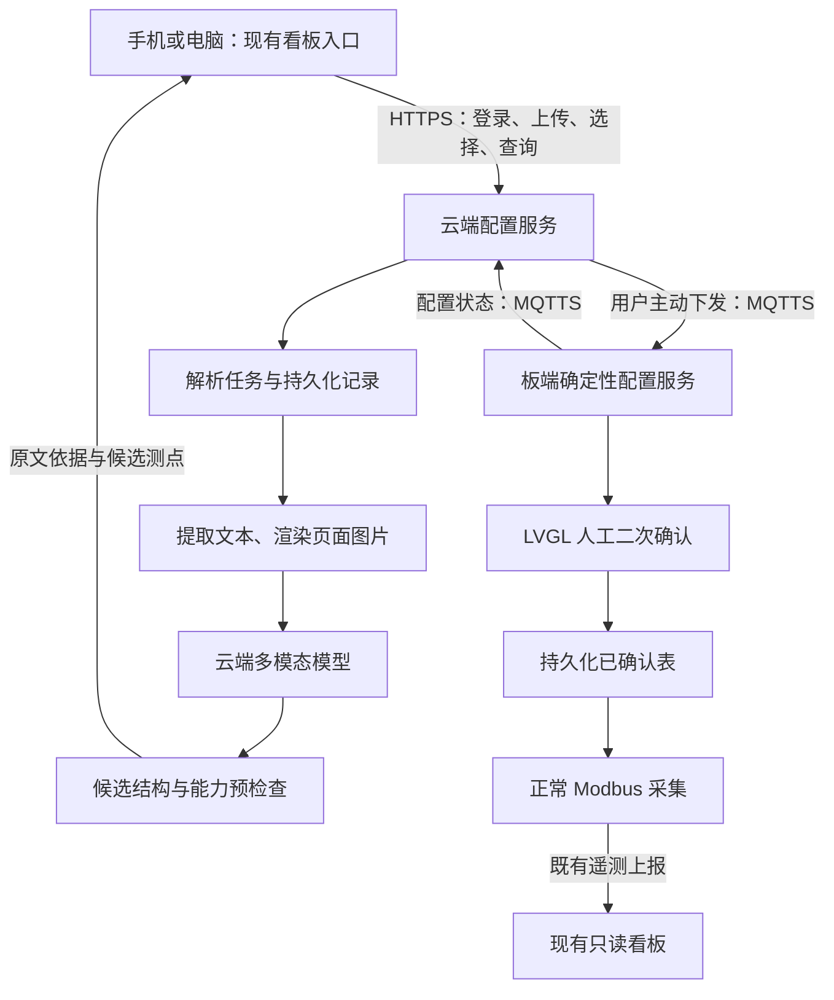

# VelaGuard 网页上传手册与传感器接入实施计划

日期：2026-10-27。

状态：用户已确认本页产品选择；本文是实施计划，尚未开始本功能的编码、部署或真机验收。后续开发按单项任务由用户选择启动。

## 1. 已确认的方案

用户通过电脑或手机浏览器访问固定网页，选择目标板端，同次提交传感器 PDF 手册和从机地址。云端解析后展示候选测点及原文依据，用户选择型号与测点，再主动下发。板端完成确定性校验后，仅弹出人工二次确认；确认后直接添加，随后由正常采集确定读数与在线状态。

本次讨论已确认：

| 项目 | 首期决定 |
|---|---|
| 用户入口 | 复用现有看板入口，增加添加传感器页面；手机与电脑共用网页 |
| 联网 | 板端通过网线或 WiFi 接入互联网；浏览器与板端无需同一局域网，不依赖手机直连板端热点 |
| 使用者 | 团队内部使用，管理少量后台预登记板端 |
| 账号 | 一个团队管理账号，不开放注册；设备登记与可访问范围由后台维护 |
| 上传内容 | 同次提交 PDF 和从机地址，目标板端必须在该账号获准访问的范围内 |
| 手册类型 | 首期同时支持文字 PDF、扫描 PDF 和混合 PDF |
| 网页预览 | 选择型号、勾选测点、查看原文依据；首期不提供寄存器地址、类型、倍率等自由编辑 |
| 解析有误 | 标记问题并重新解析，不能猜测缺失字段后直接下发 |
| 离线处理 | 板端离线时可上传、解析和保存结果；上线后由用户主动下发，不自动补发 |
| 云板通信 | 浏览器到配置服务使用 HTTPS；配置服务到板端使用专用 MQTTS 候选通道 |
| 添加方式 | 板端校验、板端人工确认、直接添加；不做试读，不提供远程确认 |
| 首期能力 | 仅新增设备，沿用实际支持的 int16/uint16；不扩展浮点、32 位整数、字序及非零偏移 |

不支持的测点必须在网页说明原因，并阻止其进入下发内容。用户可以仅选择受支持测点；所有已选择测点仍须通过板端校验。测量范围不能自动转换为告警阈值。

## 2. 与现行文档和代码的关系

本计划细化 [ADR 0007](adr/0007-mqtt-candidate-import-with-local-confirmation.md) 的网页入口、云端解析与实施顺序，不另建一套候选传输协议。消息与字段继续以 [候选接入协议草案 v0.2](velaguard-candidate-mqtt-protocol.md) 为依据；其中手机端的状态展示规则适用于本计划的手机和电脑网页。

当前事实与新增目标须分别记录：

- 板端目前只有 MQTT 上报；`vg_mqtt_session.c` 的接收回调没有候选接收实现。MQTTS、配置会话、候选存储隔离和 LVGL 本地确认仍需开发。
- 当前 ESP8266 承载用于连接外部热点，未实现可用的入站 TCP 管理服务。本方案无需新增热点管理页，不依赖该入站能力。
- 现有点表支持 int16/uint16，合并后的运行表最多 32 个测点。云端解析到更多类型时必须明确说明板端不支持。
- 当前 NSH 仍按试读、展示结果、等待人确认、单独 apply 的流程使用；设备端 Agent 不参与任何配置入口。
- 本次只读调查未在父工作区找到配套云仓 checkout。公开云仓的事实来自 `FoLeaf/velaguard_mimo2mqtt` 的提交 `6bd6b8f48433d6a5fab4f46547940a2e49b88e4c`，不代表线上部署版本。
- 该云仓使用 Python、SQLite、paho-mqtt、Pydantic 和静态网页；HTTP 服务当前只有 GET。可复用设备、点表查询及页面样式，尚无登录、PDF 上传、解析任务或配置发布。其自动发现的设备列表不能直接作为授权设备白名单。

云仓核查来源：[依赖](https://github.com/FoLeaf/velaguard_mimo2mqtt/blob/6bd6b8f48433d6a5fab4f46547940a2e49b88e4c/pyproject.toml)、[HTTP 服务](https://github.com/FoLeaf/velaguard_mimo2mqtt/blob/6bd6b8f48433d6a5fab4f46547940a2e49b88e4c/dashboard/http/server.py)、[MQTT 适配](https://github.com/FoLeaf/velaguard_mimo2mqtt/blob/6bd6b8f48433d6a5fab4f46547940a2e49b88e4c/dashboard/transport/mqtt.py)。

## 3. 系统组成与源码归属

职责划分：

- 网页负责设备选择、上传、解析预览、测点选择、主动下发、取消与状态查询。浏览器不持有模型密钥或 Broker 凭证。
- 新增配置服务负责登录与设备权限、解析任务、候选整理、MQTT 配置会话及结果记录。现有遥测采集器继续使用只读权限，配置服务使用独立凭证与 ACL。
- 云端模型只输出候选数据及来源，不直接访问 Broker，不调用配置命令。手册内容作为待解析资料，不作为执行指令。
- 板端负责字段、能力、容量、冲突、会话与版本校验，以及本地人工确认和持久化。LLM 判断不能替代这些检查。
- 本地采集、告警、LED、显示和配置日志继续离线运行，配置任务失败不影响既有运行表。

新增产品源码、部署材料与验收证据放在本专属仓；建议分别使用 `web/sensor_onboarding/` 和 `services/config_service/`，具体目录在开发任务中确定。复用同一域名可以通过路由接入新增页面与服务，不要求给现有只读 HTTP 服务直接增加配置发布权限。

板端逻辑放在本仓 `app/velaguard/`。如需修改 NuttX、apps、MQTT-C 或 packages，则修改各自实际 checkout，并按仓库规则分别提交；不创建补丁注入脚本，不直接修改 vendor 映射。

## 4. 网页操作流程

1. 用户登录，在后台预登记的设备列表中选择目标网关。页面展示网关身份、连接状态、已有设备和剩余测点容量。
2. 用户填写从机地址并上传 PDF。不扫描总线、不自动修改地址；总线沿用固定 9600。
3. 配置服务创建解析任务并返回任务标识。解析过程在后台执行，用户关闭或刷新网页后仍可查询原任务。
4. 解析完成后，网页列出手册中的型号和测点。每个测点展示名称、功能码、原文地址、协议地址、类型、倍率、偏移、单位、页码及原文依据。扫描页保留对应页面图片供查看。
5. 用户选择型号与测点。缺失必要信息、证据有歧义或板端不支持的测点显示原因，不能进入最终选择集；选择集为空时不能下发。
6. 板端离线时，结果保存在云端，不创建板端配置会话。上线后由用户点击下发；服务重新校验权限、当前设备会话和运行表基础版本。
7. 下发受理后，网页显示板端校验结果。仅在校验通过后，板端弹出对应候选版本的人工二次确认。用户可以在网页取消尚未提交的任务。
8. 用户在板端确认添加。网页根据板端实际结果显示配置生效或失败，随后单独显示正常采集产生的在线状态和真实读数。

首期不增加板端远程配置进度页、等待页或成功提示。板端仅显示人工二次确认，既有本地告警优先；确认前不产生新增候选的 Modbus 请求。

## 5. PDF 与多模态解析

云侧使用以下处理流程，实际模型名称和接口能力在第一阶段验证：

1. 校验上传类型、文件完整性和大小/页数预算。加密、损坏或无法读取的 PDF 返回明确原因。
2. 文字页提取文本及表格；扫描页渲染成图片；混合页结合文字和图片。保留原文件摘要、PDF 页序和型号关联。
3. 按章节和寄存器表组织输入，保留跨页表头与说明。长手册分段处理，不盲目把所有页面一次送入模型。
4. 将图像经实际接口支持的方式传入多模态模型。首期不强制另接 OCR；若真实样本质量不足，再评估图像预处理或 OCR 辅助。
5. 输出结构化候选及每点来源。原文地址与协议地址分别保存；地址换算、单位与倍率必须有原文依据，缺失或矛盾时标记待处理。
6. 云侧做 schema 和已知板端能力预检查，再生成网页预览。板端接收后独立执行确定性校验。

多模态支持图片输入不等同于接口支持直接上传 PDF。MiMo 官方图片接口提供 URL 和 Base64 方式，可采用 PDF 页面渲染后传图；模型名称、上下文预算和实际表格识别效果仍需用所选接口实测。[图片理解文档](https://mimo.mi.com/docs/zh-CN/quick-start/usage-guide/multimodal-understanding/image-understanding)

验收重点包括十六进制与十进制地址、地址起始偏移、倍率符号、多型号混排、跨页表格和模糊扫描页。确定性字段检查可以发现格式或能力问题，无法保证识别内容与手册一致，因此保留原文预览与真实样本对照。

## 6. 任务状态与候选传输

区分云端解析任务与板端配置会话：

| 阶段 | 状态与行为 |
|---|---|
| 云端准备 | 已上传、解析中、待处理或待预览；可离线完成，不占用板端租约 |
| 用户选择 | 保存型号与测点选择；重新解析或修改选择使旧的待下发内容失效 |
| 主动下发 | 校验权限和设备状态，按协议 open，再 put 完整候选 |
| 板端处理 | opened、validating、awaiting_local_confirm、committing、applied |
| 异常或结束 | 显示明确失败、取消或过期原因；结果暂时未知时查询实际状态，不直接判定成功或重复提交 |

沿用协议草案中的主题 `vg/{device_id}/config/request` 与 `config/state`。请求只允许 open、put、cancel、query，不提供 test、apply 或 confirm。

必须绑定 `boot_id`、`session_id`、`revision`、`base_hash` 和候选摘要。本地确认绑定屏幕上正在展示的版本与摘要；新候选、断线、取消、过期或重启使旧确认失效。已进入提交阶段的结果按协议查询，不能因网页超时重新添加。

使用 QoS 1、非 retained 请求，按请求标识与内容处理重复消息，按版本处理乱序与并发。PUBACK 只作为传输确认；配置成功须来自板端实际持久化结果。协议依据见 [MQTT 3.1.1](https://docs.oasis-open.org/mqtt/mqtt/v3.1.1/mqtt-v3.1.1.html)。

协议草案中的完整请求 16 KiB、状态 4 KiB、租约 10 分钟等为待测量预算。实现前须核实 MQTT 收包容量、JSON 转义后的完整消息大小、堆内存和界面资源；不能把这些预算写成当前已验证能力。合并后的 32 测点上限包含原有测点，不是每台传感器各 32 点。

远程候选独立存储，同步实现与 NSH、扫描等配置入口的互斥。原 NSH apply 不能读取远程候选；设备端 Agent 对两条入口均无配置权限。

## 7. 账号、文件与部署

- 固定网站使用 HTTPS。团队账号登录后才能上传、查询任务和访问预登记设备；后端对每个操作重新检查设备范围，不依赖网页隐藏按钮。
- 账号口令使用密码散列存储，登录状态使用安全会话；状态变更接口防止跨站请求，上传与模型调用设有界配额。具体会话、文件大小、页数、并发和超时数值由第一阶段实测后确定并写入部署配置。
- 云端模型密钥与专用 MQTT 凭证只保存在服务端部署配置中；板端独立凭证按现有 provision 机制管理。完整凭证不进入 Git、页面、PDF 来源字段、日志或 MQTT payload。
- PDF、页面图片和候选只能由获授权账号访问；首期图片输入可用 Base64，无需公开暴露上传手册。任务记录与文件采用可清理的持久化存储，保留期限和清理参数在部署前明确。
- 新增配置服务可延续现有 Python 与 SQLite 技术体系。上传接口和后台任务的具体实现方式，经第一阶段验证后确定，避免把模型调用放在阻塞的页面请求中。
- 配置服务使用独立 Broker 权限；遥测采集器不获得配置发布权限，LLM 不获得 Broker 权限。云侧 PDF 解析与板端运营 Agent 的 HTTPS MiMo 链路分别管理，均不通过 MQTT 传 AI 请求响应。

## 8. 分阶段实施

每阶段完成后给出结果和证据；进入下一项开发仍由用户选择。本计划不自动启动全部阶段。

| 阶段 | 工作与交付 | 通过条件 |
|---|---|---|
| P0：验证解析与资源条件 | 确认云看板部署基线；验证实际多模态接口；用文字、扫描、跨页及不支持类型手册形成样本与候选；核实板端收包及内存预算 | 能展示带页码与原文依据的候选；识别不确定和能力不支持有明确结果；记录可执行的文件、消息与并发预算 |
| P1：板端配置核心 | 实现独立远程候选、schema/能力/合并校验、版本与确认绑定、NSH 互斥、幂等和异常状态机 | 主机侧测试覆盖有效、无效、重复、乱序、过期和入口竞争；未确认不修改运行表 |
| P2：安全通信 | 实现 MQTTS 收发、Broker 身份验证、设备凭证、专用主题和 ACL | 实际连接与权限取证通过；错设备、错方向、retained 请求均不能进入有效配置流程 |
| P3：云端与网页 | 新增团队登录、设备白名单、上传、异步解析、预览选择、会话编排和状态查询；接入现有看板入口 | 手机与电脑可完成云端操作；离线解析和刷新恢复有效；使用模拟板端时明确标注模拟，不能作为真机证据 |
| P4：板端人工确认 | 接入 LVGL 二次确认、持久化提交、结果回报及正常采集；本地告警优先 | 校验通过才弹窗；只有用户在板端确认对应版本后生效；界面不出现远程配置进度或结果页 |
| P5：完整真机验收 | 联通固定网页、云模型、真实 Broker 与开发板；覆盖异常；整理部署、演示与运行证据 | 文字及扫描 PDF 均有真实成功样例，异常不改变既有表，本地安全功能持续运行，配置生效与实际采集分别有证据 |

P1、P2、P4 涉及产品协议或板端逻辑时，按范围执行 `make -C app/velaguard/host_tests test`；板端构建、烧录与验收按对应技能执行。文档整理不要求编译烧录。本轮未执行上述实现或验收。

## 9. 端到端验收清单

- 电脑和手机访问同一固定网站，无需连接板端热点；未登录或设备不在白名单时不能操作。
- 文字、扫描、混合 PDF 可形成可核对的候选；型号、地址、倍率和来源对照人工样本检查；模糊、矛盾或不支持内容不被静默填补。
- 板端离线时可解析并恢复网页任务；上线后仍须用户主动下发。
- 校验失败不弹板端确认；未确认、取消、超时和旧版确认均不改变运行表；确认前不对新增候选发 Modbus 请求。
- 有效配置经板端真实人工确认后落盘、更新采集表；离线从站可以添加，采集失败按真实离线状态展示。
- 重复请求、乱序、候选更新、NSH 竞争、断网、存储失败和重启均按协议取证；网页不会把已发送或 PUBACK 展示成添加成功。
- 断网或云侧失败时，原有采集、本地告警、LED 和显示继续运行；板端确认不遮挡本地告警。
- 浏览器、模型、MQTT 消息及设备端 Agent 均不能代替板端人工确认，不能写寄存器、清除告警或控制输出。

建议下一项由用户选择 P0：先验证真实手册解析与资源条件，再确定首个编码任务。
