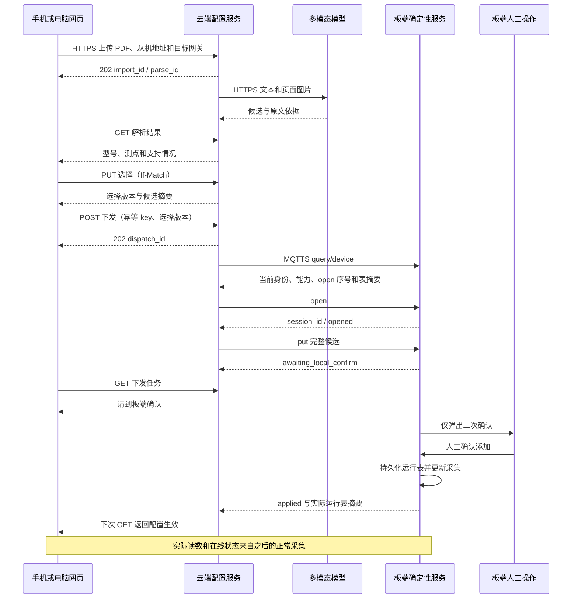

# VelaGuard 网页传感器接入业务通信协议 v0.1

日期：2026-10-28。状态：协议规划，尚未实现、部署或真机验收。

本文规划电脑/手机浏览器、云端配置服务和板端之间的业务通信，承接 [已确认实施计划](velaguard-web-sensor-onboarding-plan.md)。云板消息字段以 [MQTT 候选接入协议 v0.3](velaguard-candidate-mqtt-protocol.md) 为唯一规范，本文不复制一套候选格式或 NSH 命令。

## 1. 选定的通信方式

| 链路 | 方式 | 传输内容 |
|---|---|---|
| 浏览器 → 配置服务 | 同域 HTTPS API | 登录、PDF＋从机地址、预览选择、主动下发、取消 |
| 浏览器 ← 配置服务 | HTTPS GET 轮询 | 解析任务、设备状态、下发过程及实际结果 |
| 配置服务 ↔ 云端模型 | 服务端 HTTPS 多模态调用 | 手册文本、页面图片和结构化解析结果 |
| 配置服务 ↔ 板端 | MQTT 3.1.1 over TLS，QoS 1 | 查询、候选、取消和板端状态 |
| 板端 → 传感器 | 既有本地 Modbus RTU | 确认生效后正常采集，固定 9600 |

固定网站复用现有看板入口；配置 API 独立命名空间、服务权限和 Broker 凭证。浏览器与板端无需同一局域网，不提供热点管理页、浏览器直连 MQTT、原生 APP 或 WebSocket 的首期实现。

PDF 与页面图片只留在云侧；MQTT 仅承载有界结构化候选和状态。MQTT PUBACK、HTTP 202、云端解析完成都不代表板端添加成功。

## 2. 业务对象与标识

术语以 [CONTEXT.md](../CONTEXT.md) 为准。

| 对象 | 标识 | 生命周期与关系 |
|---|---|---|
| 网关 | device_id | 已登记并获授权的物理 VelaGuard；不是从机地址 |
| 手册 | manual_id、manual_sha256 | 原始 PDF 及摘要；摘要只校验内容，不授予访问权限 |
| 导入任务 | import_id | 绑定一个账号、目标网关、从机地址及一份 PDF，可在板端离线时创建 |
| 解析结果 | parse_id | 一次解析执行的不可变结果；重新解析生成新 parse_id |
| 测点选择 | selection_revision、payload_sha256 | 针对当前解析结果的一份型号和测点选择 |
| 下发任务 | dispatch_id | 用户一次主动下发；等于 MQTT task_id，不等于 import_id |
| 板端配置会话 | session_id | 板端接受 open 后产生，有互斥与租约；不等于 MQTT 连接 |

import_id、manual_id、parse_id、dispatch_id 为 `[A-Za-z0-9_-]{1,64}` 的不透明标识。浏览器不得依赖其编码推导账号、板端或时间。时间戳供展示，不能替代版本或身份判断。

一个导入任务的网关、从机地址和原始 PDF 创建后不可改；改这些内容需新建导入任务。一个导入任务可重新解析并产生多个历史结果，但只有当前 parse_id 可被选择。一次下发冻结所选结果、候选字节、摘要和目标身份，不在传输过程中重新调用模型。

## 3. HTTPS 通用规则

API 前缀：`/api/config/v1`。HTTP 路径版本与 MQTT 消息版本、候选版本分别管理。

- JSON 使用 UTF-8，成功响应为 application/json；上传使用 multipart/form-data。拒绝重复字段/键、未知执行字段、非法 UTF-8 和越界数值。
- 登录态使用 `__Host-vg_config` Cookie：Secure、HttpOnly、SameSite=Strict、Path=/，不设置 Domain。不能把口令或长期令牌放入 URL 或浏览器持久存储。
- GET /session 为同源页面建立匿名或已登录会话并返回 CSRF token。POST 登录成功后轮换会话和 token；所有状态变更请求，包括登录、上传和登出，都携带 `X-CSRF-Token` 并验证来源。默认不开放跨域访问，上传也不例外。[OWASP CSRF 指南](https://cheatsheetseries.owasp.org/cheatsheets/Cross-Site_Request_Forgery_Prevention_Cheat_Sheet.html)
- 每个请求在服务端检查账号和设备范围；从 import_id、parse_id、dispatch_id 或文件路径反查所属权限，不能只相信浏览器提交的 device_id。
- 登录、设备、任务、解析预览和文件响应设置 `Cache-Control: no-store`。手册内容按纯文本或受保护页面图片展示，不作为 HTML 执行。
- POST 导入、重新解析、取消、下发和 PUT 选择必须携带 `Idempotency-Key`。格式为 `[A-Za-z0-9_-]{1,64}`，由浏览器为一次用户操作生成；HTTP 自动重试保持原 key 和内容。登录和登出不使用此去重机制。
- 去重范围为账号＋方法＋路由＋key，保存请求指纹和原结果。相同 key、相同内容返回同一资源，不重复解析/下发；相同 key、不同内容返回 409 idempotency_conflict。
- multipart 指纹使用服务端计算的 PDF SHA-256、规范化的 device_id 和整数从机地址，不按可变 boundary 或文件名判断。同名字段或多个文件拒绝。
- 去重记录建议至少保留 24 小时，并覆盖关联任务全部非终态时间；结果未知的下发不能因超时清掉去重记录和设备占用。过了保留期，客户端先查原任务，不能盲目生成新 key 重放。
- 接收异步工作前先持久化任务和去重关联，再返回 202。202 返回 Location 与资源标识，用户经 GET 查询实际完成情况。[RFC 9110 第 15.3.3 节](https://www.rfc-editor.org/rfc/rfc9110.html#section-15.3.3)

网页正常查询建议每 2 秒一次；设备离线或无变化时按服务端 poll_after_ms 降频，页面不可见时进一步降频。首版采用轮询，不要求浏览器保持长连接；刷新后从任务列表恢复。

关闭页面或登出不等于取消配置任务。取消必须由用户显式发起；未确认候选仍受板端租约约束，不会因浏览器离开而自动应用。

## 4. API 清单

以下路径均相对 API 前缀：

| 方法与路径 | 用途与主要响应 |
|---|---|
| GET /session | 返回 authenticated、CSRF token；已登录时返回团队账号标识 |
| POST /session | JSON 登录；成功 200 并轮换 Cookie，失败 401 |
| DELETE /session | 登出，成功 204；不改变已存在的板端会话 |
| GET /limits | 返回实际生效的上传、解析、并发、轮询与保留预算 |
| GET /devices | 只列获授权的预登记网关，可附带最近状态与 busy 提示 |
| GET /devices/{device_id} | 查询已缓存的网关能力、点表与连接信息，明确 observed_at；不作为下发前实时握手 |
| POST /imports | 同次上传 PDF、device_id、slave_address；持久化后 202 |
| GET /imports | 账号范围的任务列表，按游标分页，建议每页最多 50 条 |
| GET /imports/{import_id} | 查询任务、当前解析结果、可选型号/测点、问题和历史下发关联 |
| GET /imports/{import_id}/manual | 受鉴权原始 PDF 下载，Content-Disposition: attachment |
| GET /imports/{import_id}/pages/{page} | 受鉴权页面图片；page 为从 1 开始的物理页序 |
| POST /imports/{import_id}/reparse | 创建新解析执行，202；不能绕过活动下发锁 |
| POST /imports/{import_id}/cancel | 取消云端准备/解析任务；不隐式取消已发往板端的任务 |
| GET /imports/{import_id}/selection | 查询当前选择和强 ETag |
| PUT /imports/{import_id}/selection | 按 If-Match 修改型号和测点选择，成功 200 |
| POST /imports/{import_id}/dispatches | 用户主动下发当前选择，202 返回 dispatch_id |
| GET /dispatches/{dispatch_id} | 查询当前下发任务，包含实际板端状态及连接不确定性 |
| POST /dispatches/{dispatch_id}/cancel | 取消尚未提交的下发；受理 202，已知 too_late 为 409 |

首期不提供注册、设备转移、设备白名单修改、寄存器编辑、远程确认、试读或删除运行设备 API。账号和设备登记由部署维护完成，不能通过自动发现列表直接获得操作权限。

## 5. 上传与解析

### 5.1 创建导入任务

POST /imports 的 multipart 只允许：

| 字段 | 约束 |
|---|---|
| file | 恰好一份 PDF；检查真实格式、可读取性、大小与页数，不只检查扩展名 |
| device_id | 账号获准访问的已登记网关 |
| slave_address | 十进制整数 1..247，不允许广播地址；网关仍可离线 |

返回 202，Location 指向 GET /imports/{import_id}：

```json
{
  "import_id": "imp-example-001",
  "device_id": "vg-00112233445566778899aabb",
  "slave_address": 1,
  "manual": {
    "manual_id": "man-example-01",
    "sha256": "aaaaaaaaaaaaaaaaaaaaaaaaaaaaaaaaaaaaaaaaaaaaaaaaaaaaaaaaaaaaaaaa",
    "page_count": 12
  },
  "parse_id": "parse-example-001",
  "parse_state": "queued",
  "poll_after_ms": 2000
}
```

上传完成后原始文件有界落盘，记录服务端计算的 SHA-256；不得使用用户文件名拼接存储路径。PDF 损坏、加密不可读、超限等返回明确原因，不自动进行有副作用的外部操作。

### 5.2 解析结果状态

`parse_state` 只允许：

| 状态 | 含义 |
|---|---|
| queued | 任务已持久化，等待解析 |
| parsing | 正在提取文字、渲染页面或调用模型 |
| review_ready | 有可供用户核对的型号和候选，仍未下发 |
| needs_attention | 有缺失/矛盾/能力不支持等问题，无法形成有效选择 |
| parse_failed | 文件或模型等执行失败，包含明确原因 |
| cancelled | 已停止接受本次执行结果 |

解析结果按型号分组，每点提供稳定 point_id、运行字段、原文地址与基准、来源页码、摘录和 `eligibility`。eligibility 只允许 selectable、unsupported、ambiguous、incomplete；后三类附带具体原因，不能被选入候选。单份手册可以含不支持测点，只要用户选择集全部有效即可继续。

文字 PDF 优先结合可提取文本，扫描页通过渲染图片交给多模态模型；保留跨页表头和原文页面。页码统一按 PDF 物理页序计数，手册印刷页码可以另作展示，不能混用。

模型调用由后端内部模块完成，不暴露浏览器直调模型接口。输入绑定 manual_sha256 和 parse_id；输出只作为待验证数据。服务端检查结构、来源引用、字段完整性和已知板端能力，不允许模型提供脚本、Broker 操作或任意配置命令。

重新解析请求携带 expected_parse_id；与当前结果不符返回 409。受理后生成新 parse_id，清空当前选择并提升选择版本；迟到的旧模型结果只能归档，不能覆盖当前结果。取消后不再采纳该次执行的迟到结果，也不承诺已发出的模型调用能够撤销计费。

当前导入存在 preparing、device_session 或 reconciling 下发任务时，禁止重新解析、编辑选择或取消整个导入，返回 409 import_locked；用户应先按下发任务入口取消或核对结果。

### 5.3 云端模型调用约定

首期由配置服务中的模型适配模块发起 HTTPS 多模态请求，不暴露浏览器直接调用入口，也不增加模型回调板端的接口。采用实际服务支持的 Chat Completions 兼容图片输入；以下是消息形状示例，模型 ID、完整提示词和真实图像在部署/任务中提供：

```json
{
  "model": "DEPLOYMENT_MODEL_ID",
  "stream": false,
  "messages": [
    {
      "role": "user",
      "content": [
        {
          "type": "text",
          "text": "解析所附手册第12页的寄存器表，按服务端约定的JSON结构返回测点与原文依据。"
        },
        {
          "type": "image_url",
          "image_url": {
            "url": "data:image/png;base64,BASE64_IMAGE_PLACEHOLDER"
          }
        }
      ]
    }
  ]
}
```

- 请求示例中的 model 必须替换为已验证支持图片的实际模型 ID。服务端在部署配置中保存端点和密钥，并通过提供商规定的认证头发送；密钥不进入 messages 或业务日志。
- 页面图片优先作为 Base64 输入，避免公开上传手册的访问地址；文字页也可提供已提取文本。输入清单记录 manual_sha256、parse_id、每张图片对应的物理页序，分段时保持同一手册及跨页上下文。
- 首期采用 stream=false，完成整段响应后才验证和发布解析结果。接口支持结构化输出时可启用，但实际输出仍必须校验；不依赖展示出来的推理过程作为测点依据。
- 适配模块只接收型号、测点字段、原文地址/基准、页码和摘录等数据。通过已约定版本的解析 schema 后，服务端生成稳定业务 ID，计算 eligibility 并保存；不接受模型调用 Broker、执行命令或指定下发行为。
- 一次模型响应只能更新服务端仍在执行的对应 parse_id。模型回显的 task_id、设备身份或建议动作不作为权限与状态依据。
- 超时或传输结果未知时标记本次解析失败，不自动反复调用。只有提供商明确未受理或提供了经验证的幂等机制时，才允许在总预算内有界重试；用户重新解析生成新 parse_id。
- 提供商响应 ID、耗时和用量可用于审计；错误对网页只暴露有界错误码，不返回认证头、完整提示词或原始错误栈。

图片输入形状依据 [MiMo 官方图片理解文档](https://mimo.mi.com/docs/zh-CN/quick-start/usage-guide/multimodal-understanding/image-understanding)；接口支持图片不代表直接支持 PDF，页面渲染和实际模型调用效果仍待 P0 验证。

## 6. 测点选择与版本控制

GET /selection 返回当前选择；尚未选择时 selection_revision=0、payload_sha256=null。响应附强 ETag，如 `"selection-0"`。

PUT /selection 必须带对应 If-Match，不允许通配符；缺少时返回 400 precondition_required，不匹配返回 412 selection_changed。强 ETag 用于避免旧页面覆盖较新选择，依据 [RFC 9110 第 13.1.1 节](https://www.rfc-editor.org/rfc/rfc9110.html#section-13.1.1)。

请求体只允许：

```json
{
  "parse_id": "parse-example-001",
  "sensor_model_id": "model-example-01",
  "point_ids": [
    "s1_f3_r0"
  ]
}
```

- parse_id 必须是当前结果，sensor_model_id 必须来自该结果，point_ids 必须非空、不重复且均属该型号、均为 selectable。
- 浏览器只能选择，不能提交任意寄存器、倍率、阈值或来源字段。服务端从已保存结果构建候选。
- 服务端按稳定规则生成运行 point ID，构造完整 candidate_json 并冻结其 UTF-8 字节；云端预检查后计算 payload_sha256。
- 成功后 selection_revision 增加，返回新的 ETag。相同 Idempotency-Key 的网络重试仍返回原结果，不再增加版本。
- 实际类型、字段长度、容量和现有地址冲突最终仍由板端校验；缓存能力只能用于网页提前提示。

返回 200，ETag 为 `"selection-1"`：

```json
{
  "import_id": "imp-example-001",
  "parse_id": "parse-example-001",
  "selection_revision": 1,
  "sensor_model_id": "model-example-01",
  "point_ids": [
    "s1_f3_r0"
  ],
  "payload_sha256": "a90dc6eef1ccc60a8eb8c660d85d49d2d8c8089262495742d9f652790659434a",
  "dispatchable": true,
  "issues": []
}
```

payload_sha256 是候选原始字节摘要，不是整份手册摘要，也不是未来合并后的运行表摘要。三种摘要的口径以 MQTT 协议为准。

selection 响应是按版本保存的固定快照；dispatchable 只表示这份选择通过云侧静态预检查，不表示设备当前在线、空闲或最终校验通过。实时设备与下发信息放在各自资源中，不能在不更新 ETag 的情况下改变 selection 表示。

## 7. 主动下发与结果查询

### 7.1 创建下发任务

POST /imports/{import_id}/dispatches 必须有 Idempotency-Key，body 为：

```json
{
  "parse_id": "parse-example-001",
  "selection_revision": 1,
  "payload_sha256": "a90dc6eef1ccc60a8eb8c660d85d49d2d8c8089262495742d9f652790659434a"
}
```

服务端在事务中校验账号、目标网关、当前 parse_id、选择版本、摘要以及无活动下发。版本不匹配返回 409 selection_changed，不能默默换成最新选择；创建成功后冻结快照，并为该网关占用一个云端下发槽。

该 POST 指向下发集合，不使用另一个 selection 资源的 ETag 作为 If-Match；选择并发检查明确使用 body 中的版本和摘要。

返回 202，Location 指向 GET /dispatches/{dispatch_id}：

```json
{
  "dispatch_id": "cfg-example-001",
  "import_id": "imp-example-001",
  "device_id": "vg-00112233445566778899aabb",
  "phase": "preparing",
  "device_state": null,
  "outcome": null,
  "poll_after_ms": 2000
}
```

配置服务后台执行以下顺序：

1. 持久化下发记录，确认本次操作未被取消。
2. 通过 MQTT query/device 取得匹配本次 req_id 的实时能力、boot_id、link_id、next_open_seq 和 base_hash。设备离线、协议未实现或配置不可用时不发送 open/put，回报具体原因。
3. 再次检查选择、已知能力与容量，持久化将发送的请求标识和完整字节，再发送 open。
4. 接受匹配任务的 open 状态，取得 session_id；在会话有效且当前候选仍为冻结版本时发送 put。
5. 板端验证并等待本地确认；网页提示用户前往板端确认，只显示实际回传的状态。
6. 用户在板端确认后，按 state/applied 或可核对的提交 receipt 显示配置生效。随后使用既有遥测查询显示实际读数和在线状态。

浏览器不发送 MQTT boot/session 参数，也不提供 confirm 字段。服务端不能因为解析完成、设备后来上线、网页刷新或后台重启自动创建新的下发任务。

### 7.2 下发状态

GET /dispatches/{dispatch_id} 返回持久化任务及最新板端快照，字段至少包括：

| 字段 | 约束 |
|---|---|
| dispatch_id、import_id、device_id | 固定身份 |
| parse_id、selection_revision、payload_sha256 | 本次冻结选择 |
| phase | preparing、device_session、reconciling 或 finished |
| device_state | null 或 MQTT 协议中的真实 state，不由云端猜测推进 |
| outcome | 未结束为 null；确定结果为 applied/cancelled/expired/failed；无法核对时为 unknown 且 phase=reconciling |
| connectivity | connected、offline 或 uncertain |
| board_snapshot | 匹配任务的最后状态，含 boot/session/state_seq；首次响应前为 null |
| applied_hash | 仅在实际生效有证据时填写，其余为 null |
| last_error | 有界错误码、是否可重试与字段问题 |
| poll_after_ms | 网页建议查询间隔 |

phase 与 connectivity 由云端管理，device_state 来自板端，两者不混用。HTTP 查询到一个失败任务仍返回 200；失败是该资源的内容，不把 GET 本身写成配置执行失败。

网页必须分别呈现：解析完成、校验通过/等待本地确认、配置生效、正常采集在线。新测点在首次真实采样前显示尚无读数，不生成试读值或估算值。

### 7.3 取消与结果未知

- 尚未发出 open 的 preparing 任务，可在服务端原子标记取消并阻止后续发送。
- open 已发但未收到响应时，不能宣称已取消；先 query/task 核对，若获得会话则定向 cancel。
- 已知会话发送 MQTT cancel 后，只有收到 cancelled/expired 等实际终态才完成云端取消；HTTP 202 只表示取消请求受理。
- committing/applied 返回 too_late；取消不能回滚已确认运行表。
- 断线、HTTP 超时、云端重启或丢失回执时，进入 reconciling，按原 task 查询。不能为了结束等待而新建任务或重发新版本。
- 当前板端无法提供旧任务结果时，保持 unknown 并提示核对运行表；不把 unknown_task 自动映射为 failed/applied。解除无法恢复的云侧占用需维护人员核对当前运行表与无活动会话后审计处理，不能调用远程确认。
- 收到板端 recovery_unknown 状态或结果不明的 receipt 时，phase 进入 reconciling、outcome 为 unknown，不能按普通失败释放占用后自动重试。
- 后台重启只恢复查询对账。确定尚未发送变更的任务可结束为 failed/service_restarted；已可能发出的任务必须先核对，不能依赖尚未执行的发送队列自动补发。

同一网关最多一个活动下发；同一导入最多一个活动下发。云端已终态并持久化结果后才能释放对应占用。板端互斥仍是最终约束，不能只依赖云端数据库锁。

## 8. HTTP 错误格式

错误采用 application/problem+json，基础字段遵循 [RFC 9457](https://www.rfc-editor.org/rfc/rfc9457.html)，扩展 code、retryable、correlation_id 和 field_errors：

```json
{
  "type": "urn:velaguard:problem:selection_changed",
  "title": "测点选择已更新",
  "status": 409,
  "detail": "请刷新当前选择，再由用户重新发起下发。",
  "instance": "/api/config/v1/imports/imp-example-001/dispatches",
  "code": "selection_changed",
  "retryable": false,
  "correlation_id": "http-example-001",
  "field_errors": []
}
```

| HTTP | 主要含义 |
|---|---|
| 400 | JSON/multipart 格式、重复字段、缺少必要前置条件或未知字段 |
| 401 / 403 | 未登录；已登录但 CSRF 或操作权限不满足 |
| 404 | 对象不存在，或账号不具备该对象的查看权限 |
| 409 | 活动任务冲突、选择变化、幂等内容冲突、已提交不能取消 |
| 412 | PUT 选择的 If-Match 不匹配 |
| 413 / 415 | 文件/请求超限；不支持的媒体格式 |
| 422 | 业务字段不合法、选择包含不支持测点、手册不可用 |
| 429 | 账号、上传、模型或查询配额超限，附 Retry-After |
| 503 | 服务或解析依赖暂不可用；说明是否可重试 |

异步解析中的 provider 错误和异步板端错误记录在任务资源内，不改变之前的 202。field_errors 最多 16 条，字段路径明确，不返回栈、完整提示词、模型密钥、Broker 凭证或候选全文。

## 9. 限额与资源释放

GET /limits 返回实际部署值；以下是用于后续 P0 验证的初始建议，不是已支持能力：

| 项目 | 建议起始预算 |
|---|---|
| PDF 原始大小 / 页数 | 20 MiB / 100 页 |
| 单团队解析并发 / 等待队列 | 1 个执行 / 最多 2 个等待 |
| 单次解析执行时间 | 300 秒；超时标记明确，不自动反复调用模型 |
| 单次结构化解析测点 | 最多 256；超出明确报 parse_result_limit，不把截断结果当完整解析 |
| 普通 JSON 请求 | 64 KiB，文件上传单独计量 |
| 网页轮询 | 正常建议 2 秒；离线建议 10 秒，服务端限流 |
| MQTT 请求 / 状态 | 取板端能力与云端配置的较小值，目标上限分别 16 KiB / 4 KiB |
| 原始文件和解析结果保留 | 建议终态后 30 天；活跃/结果未知的下发及关联来源不得按普通清理删除 |
| HTTP 幂等记录 | 至少 24 小时且覆盖关联非终态任务 |

超时、取消后停止接受迟到结果；图片渲染、模型输入和提取输出均设有界预算。清理文件必须先核对任务引用；保留必要的有限审计元数据和已应用候选来源，实际保留配置在部署说明中登记。

## 10. 完整时序



## 11. 实施与验收入口

HTTP、云端内部解析和 MQTTS 先按本文及配套候选协议完成黄金消息/状态用例，再进入实现。重点覆盖上传幂等、旧解析结果、旧网页选择、离线解析、重复下发、账号越权、消息重放、取消竞争、配置入口互斥和重启后对账。

板端实现与真机验收遵守仓库对应技能；本轮只有文档，没有调用模型、连接 Broker、修改点表、编译、烧录或部署。研发与验收不通过文档自动启动。
